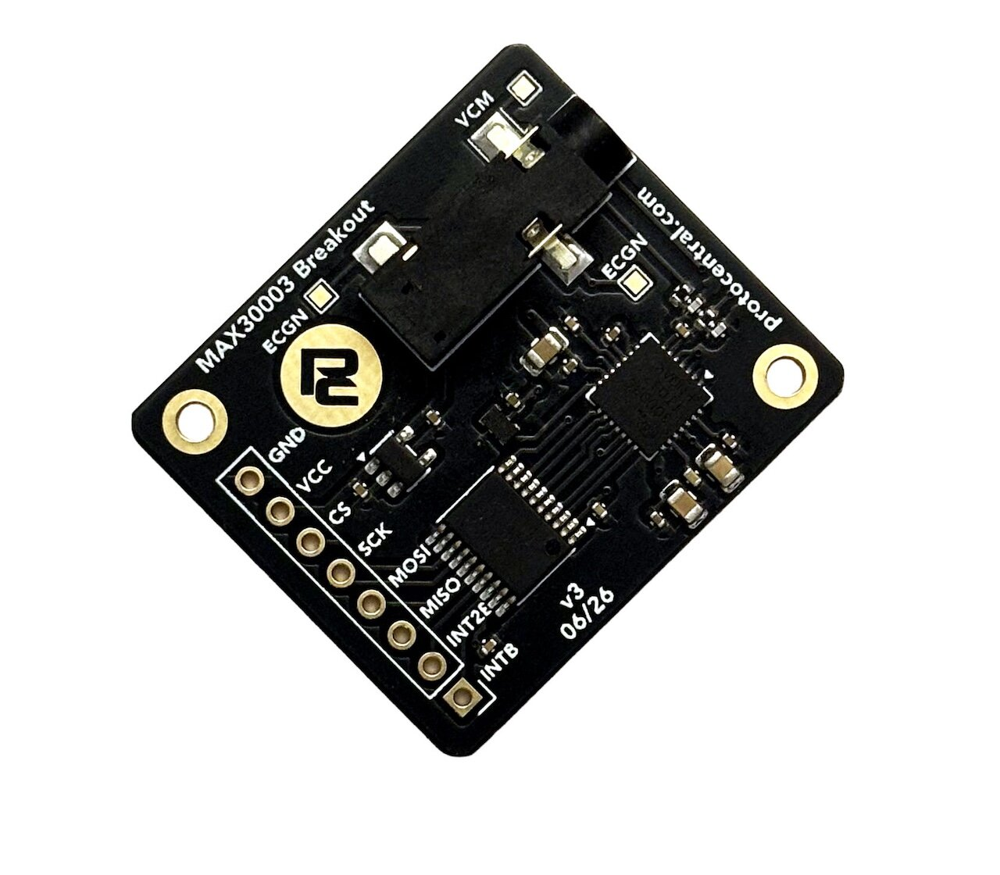

# ProtoCentral MAX30003 Single-lead ECG Breakout — Hardware

Open-source hardware design files for the **ProtoCentral MAX30003 Single-lead ECG Breakout**, built around the [Analog Devices (Maxim) MAX30003](https://www.analog.com/en/products/max30003.html), an ultra-low-power single-channel biopotential AFE with built-in R-to-R (heart-rate) detection.

The board takes a single ECG lead from a standard 3.5 mm electrode cable. It runs the MAX30003 from an on-board 1.8 V rail and translates the SPI and interrupt lines to your host's logic level, so it connects directly to 3.3 V or 5 V microcontrollers.

## Links

| | |
|---|---|
| 🛒 Product page | https://protocentral.com/product/protocentral-max30003-single-lead-ecg-breakout-board-v2/ |
| 💻 Arduino library | https://github.com/Protocentral/protocentral_max30003 |
| 📄 IC datasheet (Analog Devices / Maxim) | https://www.analog.com/media/en/technical-documentation/data-sheets/max30003.pdf |

## Specifications (v3)

- **AFE:** MAX30003 single-channel ECG front end with R-to-R detection
- **Electrode input:** 3.5 mm jack (Tip = ECGN, Ring = ECGP, Sleeve = VCM), 49.9 kΩ series resistors and an RC EMI filter on each input
- **Interface:** SPI (`CSB`, `SCLK`, `MOSI`, `MISO`) plus `INTB` / `INT2B` interrupts, level-translated to host `VCC` by a TXB0108
- **Clock:** on-board SiT1533 32.768 kHz oscillator driving `FCLK`
- **Supply:** 3.3 V – 5 V on `VCC`; on-board AP2112K-1.8 LDO for the AFE
- **Host header (J2, 8-pin):** 1 `INTB` · 2 `INT2B` · 3 `MISO` · 4 `MOSI` · 5 `SCLK` · 6 `CSB` · 7 `VCC` · 8 `GND`
- **Board:** 33.0 × 28.6 mm, 2-layer

## Revisions

| Revision | Design files | Notes |
|---|---|---|
| **v3** (current) | [`hardware/`](hardware/) | KiCad 10 redesign; [schematic PDF](hardware/protocentral-max30003-v3-schematic.pdf) |
| v2.0 | [`hardware/previous-revisions/v2.0/`](hardware/previous-revisions/v2.0/) | Eagle (2018) |
| v1.1 | [`hardware/previous-revisions/v1.1/`](hardware/previous-revisions/v1.1/) | Eagle (2017) |
| v1.0 | [`hardware/previous-revisions/v1.0/`](hardware/previous-revisions/v1.0/) | Eagle (2017) |

The v2.0 files also remain in the original [protocentral_max30003](https://github.com/Protocentral/protocentral_max30003/tree/master/hardware) repository, so existing links keep working.

## Repository layout

| Folder | Contents |
|---|---|
| [`hardware/`](hardware/) | v3 KiCad project (schematic + PCB layout) and the exported [schematic PDF](hardware/protocentral-max30003-v3-schematic.pdf) |
| [`hardware/previous-revisions/`](hardware/previous-revisions/) | Eagle design files for v1.0, v1.1 and v2.0, kept for reference |

## Important notice

This device is intended for research, education, and evaluation use only. It is **not** a medical diagnostic instrument and is not FDA, CE, or FCC approved for consumer use.

## License

The hardware design files in this repository are licensed under the **CERN Open Hardware Licence Version 2 – Permissive (CERN-OHL-P v2)**. See [LICENSE](LICENSE).

The accompanying Arduino library (in the separate [protocentral_max30003](https://github.com/Protocentral/protocentral_max30003) repository) is licensed under the MIT License.
